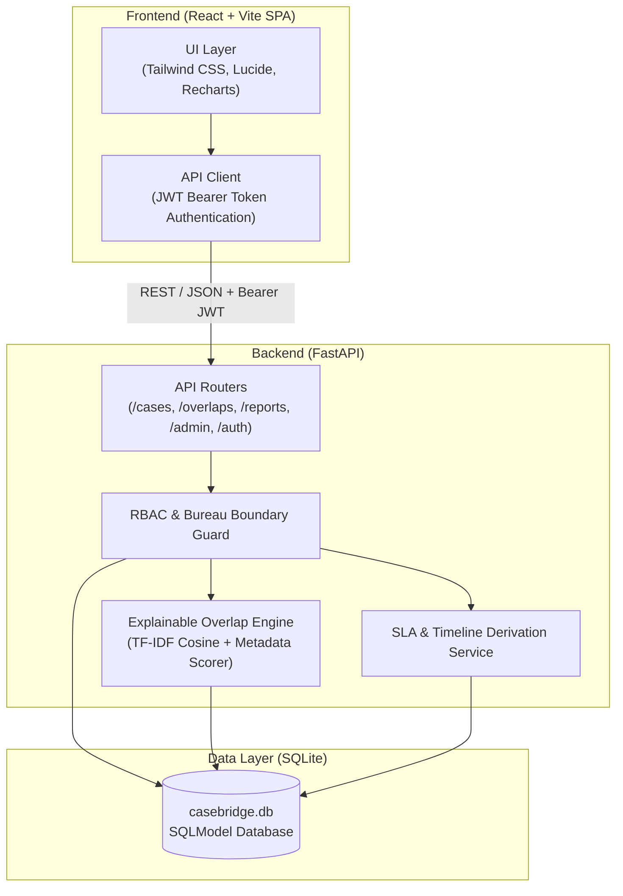

# CaseBridge

CaseBridge is an internal grievance monitoring and coordination desk designed to give administrative officers a consolidated view of complaint cases filed against technical institutions across operational bureaus.

When complaints arrive through separate administrative divisions—such as the Regulation Bureau (RB), the Public Grievance Redressal Cell (PGRC), Regional Offices (RO), or Other Cells (OC)—officers often lack visibility into concurrent inquiries. CaseBridge indexes cases by institutional Permanent ID, maintains an append-only event log, and surfaces potential cross-bureau overlaps for human review before duplicate inquiries lead to conflicting actions.

> **Note:** All test and demo records are synthetic sample data created for functional evaluation. CaseBridge is an independent software prototype and is not connected to live production databases.

---

## Architecture & Core Workflow



```
Incoming Complaints (RB / PGRC / RO / OC)
               │
               ▼
   Institution Indexing (Permanent ID)
               │
               ▼
   Deterministic Case Ingestion (Sequential Case Numbers + Append-Only Log)
               │
               ▼
   Explainable Overlap Engine (TF-IDF Similarity + Category + Reference Matching)
               │
               ▼
   Coordination Queue (Human Coordinator Decision: Related / Duplicate / Distinct)
               │
               ▼
   Consolidated Institutional History & Cross-Bureau Audit Trail
```

### Key Capabilities

1. **Consolidated Institution Profiles**: Technical institutions are indexed by authoritative Permanent ID (`DEMO-XXXX`). Profiles aggregate active inquiries, historical complaints, bureau distribution, and SLA ageing across all bureaus.
2. **Append-Only Case Audit Trail**: Cases receive sequential identifiers (`PREFIX-YYYY-NNNNN`). Status transitions, notes, bureau reassignments, and escalations are stored as immutable `case_events` with actor attribution and timestamps.
3. **Overlap Detection Engine**: Automatically flags pairs of cases concerning the same institution received within 365 days. Scores pairs into confidence bands (**High**, **Medium**, **Low**) using TF-IDF cosine similarity, shared reference code matching, category correlations, and filing date proximity.
4. **Human Review Governance**: The detection engine never closes, merges, or reassigns cases automatically. Candidate pairs appear in a dedicated Coordination Queue where an authorized coordinator records an explicit decision (`duplicate`, `related`, `not_related`, `needs_review`), appending the outcome to both cases.
5. **Role-Based Visibility**:
   - **Bureau Officers**: Full case details and actions for their assigned bureau; cross-bureau matters for the same institution display masked summaries to preserve internal remarks.
   - **Central Coordinators**: System-wide case visibility, reassignment authority, and overlap queue triage.
   - **Senior Management**: Executive read-only dashboard access with KPI analytics.
   - **Administrators**: User provisioning, dynamic SLA threshold tuning, data health metrics, and audit log inspection.
6. **Reporting & Data Export**: Aggregated analytics across seven dimensions (Bureau, Status, Category, Region, Ageing, Disposal, Overlap Outcomes) with one-click CSV export matching exact database sums.

---

## Overlap Detection & Evaluation

The engine balances recall with precision to avoid overwhelming coordinators with false alarms. Scoring combines text similarity with metadata signals:

- **High Band**: TF-IDF similarity $\ge 0.16$ alongside shared category or reference code.
- **Medium Band**: TF-IDF similarity $\ge 0.14$ or strong reference code correspondence.
- **Low Band**: Category matches without lexical overlap, or pairs falling below operational thresholds.

### Benchmark Performance

Evaluated against an independent, ground-truth dataset with hidden shared issue scenarios (`data/eval/hidden_issues.csv`):

| Evaluation Split | Precision | Recall | F1 Score | TP | FP | FN | TN | Total Pairs |
|:---|:---:|:---:|:---:|:---:|:---:|:---:|:---:|:---:|
| **Development Split (23 insts)** | **0.860** | **0.533** | **0.658** | 49 | 8 | 43 | 404 | 504 |
| **Test Split (22 insts)** | **0.893** | **0.761** | **0.822** | 67 | 8 | 21 | 386 | 482 |
| **All Scored Pairs (45 insts)** | **0.879** | **0.644** | **0.744** | 116 | 16 | 64 | 790 | 986 |
| *Naive Baseline (flag all)* | *0.183* | *1.000* | *0.309* | 180 | 806 | 0 | 0 | 986 |

- **False Alarm Reduction**: Coordinator false positives dropped from 806 (naive baseline) down to 16 (**98.0% reduction**).
- **Idempotent Scans**: Running rescans across the dataset produces **0 duplicate links**.
- Detailed methodology, parameter bounds, and disclosures are available in [`docs/eval.md`](docs/eval.md).
- Real counts are verified continuously via `python scripts/metrics.py`.

---

## Quickstart

### Prerequisites

- **Python**: 3.11 or higher
- **Node.js**: v18 or higher (v20+ recommended)
- **npm**: v9 or higher

---

### Backend Setup

```bash
cd backend

# Create virtual environment
python -m venv .venv

# Activate virtual environment
# macOS / Linux:
source .venv/bin/activate
# Windows:
.venv\Scripts\activate

# Install dependencies
pip install -r requirements.txt

# Start backend server
python run.py
```

The API will be available at `http://127.0.0.1:8000`.  
OpenAPI documentation is hosted at `http://127.0.0.1:8000/docs`.

#### Environment Configuration (`backend/.env`)

| Variable | Default | Purpose |
|:---|:---|:---|
| `ENV` | `dev` | Application mode (`dev` allows dev secret fallback; `prod` requires explicit `JWT_SECRET`) |
| `JWT_SECRET` | *random string* | Secret key for signing bearer tokens |
| `ALLOW_DEMO_LOGIN` | `true` | Enables role-switching accounts for evaluation |
| `AUTO_SEED` | `true` | Automatically seeds baseline data if database is empty |
| `CORS_ORIGINS` | `http://localhost:5173,...` | Comma-separated list of allowed frontend origins |

---

### Frontend Setup

```bash
cd frontend

# Install packages
npm install

# Start Vite dev server
npm run dev
```

The interface will be available at `http://localhost:5173`.

---

## Role Matrix & Demo Credentials

When `ALLOW_DEMO_LOGIN=true`, quick-login accounts are accessible directly on the `/login` screen:

| Username | Role | Jurisdiction | Primary Capabilities | Password Config |
|:---|:---|:---|:---|:---|
| `coordinator` | `coordinator` | All Bureaus | Global case view, overlap queue decisions, case transfers & escalations | `DEMO_COORDINATOR_PASSWORD` |
| `officer_rb` | `bureau_officer` | `RB` | Full RB case details; masked summaries for other bureaus; status updates | `DEMO_OFFICER_PASSWORD` |
| `officer_pgrc` | `bureau_officer` | `PGRC` | Full PGRC case details; masked summaries for other bureaus; status updates | `DEMO_OFFICER_PASSWORD` |
| `officer_ro` | `bureau_officer` | `RO` | Full RO case details; masked summaries for other bureaus; status updates | `DEMO_OFFICER_PASSWORD` |
| `officer_oc` | `bureau_officer` | `OC` | Full OC case details; masked summaries for other bureaus; status updates | `DEMO_OFFICER_PASSWORD` |
| `management` | `senior_management` | All Bureaus | Executive read-only visibility for KPI summaries, analytics, and reports | `DEMO_MANAGEMENT_PASSWORD` |
| `admin` | `administrator` | System-wide | User management, SLA parameter configuration, data quality checks, audit logs | `DEMO_ADMIN_PASSWORD` |

*Demo account passwords can be customized via `.env` (refer to `.env.example`).*

---

## Verification & Testing

The repository includes a comprehensive test suite covering API contracts, role permissions, state transitions, and regression baselines:

```bash
# 1. Run backend unit & integration tests (126 tests)
pytest backend/tests -q

# 2. Run deterministic regression check (33 assertions across multiple runs)
python scripts/regression_check.py --runs 3

# 3. Print real-time consistency metrics (tests, seed dataset, and evaluation metrics)
python scripts/metrics.py

# 4. Evaluate overlap detection accuracy against evaluation ground truth
python scripts/evaluate_overlap.py

# 5. Frontend typecheck and linting
cd frontend
npm run build
npm run lint
```

---

## Project Structure

```
CaseBridge/
├── backend/
│   ├── app/
│   │   ├── main.py          # FastAPI application, CORS, lifespan hooks
│   │   ├── db.py            # SQLite engine, sessions, schema creation
│   │   ├── models.py        # SQLModel schema (Case, Institution, Event, Overlap, User)
│   │   ├── permissions.py   # Bureau and role access guards
│   │   ├── routers/         # REST API endpoints (cases, overlaps, admin, reports, etc.)
│   │   └── services/        # Overlap scoring, SLA alert derivation, metrics
│   ├── run.py               # Development entrypoint
│   └── tests/               # Pytest suite
├── frontend/
│   ├── src/
│   │   ├── api/client.ts    # Typed fetch client with Bearer token authentication
│   │   ├── components/      # Reusable UI components (Navbar, Footer, Modals)
│   │   ├── pages/           # Views (Overview, Cases, Overlaps, Reports, Admin, Login)
│   │   └── App.tsx          # Application shell & routing
│   ├── package.json
│   └── vite.config.ts
├── data/
│   ├── seed/                # Seed CSV records (institutions, cases, events)
│   ├── eval/                # Ground-truth evaluation split
│   └── eval_fresh/          # Confirmatory test split
├── docs/                    # Technical specifications, PRD, and evaluation documentation
├── scripts/                 # Seed, evaluation, and regression test scripts
└── render.yaml              # Backend deployment blueprint
```

---

## Documentation Index

- [`docs/00_CENTRAL_PRD.md`](docs/00_CENTRAL_PRD.md): Master Product Requirements Document.
- [`docs/eval.md`](docs/eval.md): Evaluation methodology, ground-truth construction, and metrics tables.
- [`docs/assumptions.md`](docs/assumptions.md): System boundaries, data schemas, and domain decisions.
- [`docs/deployment.md`](docs/deployment.md): Deployment architecture, environment variables, Render, and Vercel.
- [`PROGRESS.md`](PROGRESS.md): Verified delivery milestones, test passes, and delivery logs.
